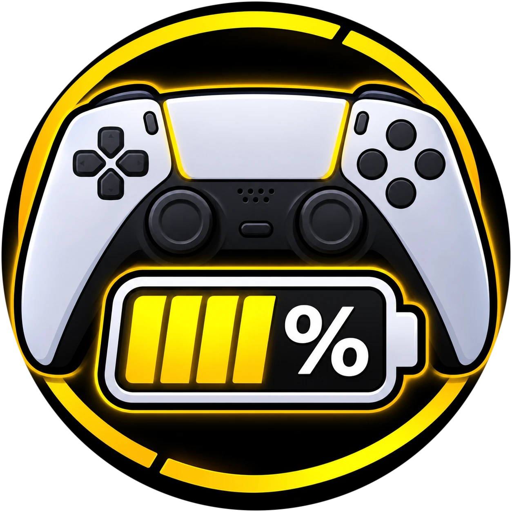
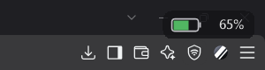
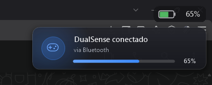
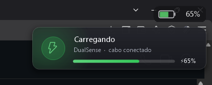
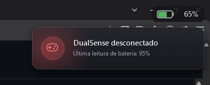

<p align="center"></p>

# Gamepad Battery Overlay


> 🇬🇧 **English:** the program is available in English (tray menu > *Idioma / Language*). The full English guide is in **[ReadMe.txt](ReadMe.txt)**.

Overlay e notificações de bateria dos controles **DualSense (PS5)**, **DualShock 4 (PS4)** e **Xbox** para Windows, **sem programas de terceiros**: não usa DS4Windows, DSX nem Steam, e não precisa de instalação. A bateria é lida direto do controle com as APIs que já vêm no Windows.

**Autor:** Rafael Gonçalez · **Versão:** 1.6.1

> 🆓 **Programa 100% gratuito. A venda é proibida.** O único lugar oficial para baixar é este GitHub. Se alguém te cobrou por ele, você foi enganado. A licença ([PolyForm Noncommercial 1.0.0](LICENSE)) permite usar, copiar, modificar e compartilhar de graça, mas proíbe vender ou usar comercialmente.
>
> 🇬🇧 *Free software. Selling it is prohibited. If someone charged you for it, you were scammed.*

> Até a v1.5 o projeto se chamava **DualSense Battery Overlay**. Quem atualiza não perde as configurações: elas passam sozinhas para o nome novo.

| Controle | Status |
|---|---|
| DualSense (PS5) | ✅ testado (Bluetooth e USB) |
| DualShock 4 1ª geração (CUH-ZCT1) | ✅ testado (Bluetooth e USB) |
| DualShock 4 2ª geração (CUH-ZCT2) | 🟡 suportado, não testado |
| DualSense Edge | 🟡 suportado, não testado |
| Xbox Series X\|S | ✅ testado (Bluetooth) · USB: "USB mode" |
| Xbox One S / Elite 2 | 🟡 suportado, não testado |

> 🤖 **Feito com vibe-coding.** Todo o código deste projeto foi escrito em conversa com uma IA (Claude, da Anthropic). As ideias, os testes e as decisões são de Rafael Gonçalez.



| Conectado | Carregando | Desconectado |
|---|---|---|
|  |  |  |

## Funções

- **Overlay da bateria**: uma linha por controle (`PS5 65%`, `PS4 45%`), sempre por cima das outras janelas, com o clique passando através dele. Não aparece no Alt+Tab e não rouba o foco. A cor muda com o nível (verde, amarelo, vermelho; azul com raio quando está carregando).
- **Alerta obrigatório abaixo de 10%**: o controle com bateria crítica aparece na tela mesmo com o overlay oculto, junto com o aviso "Bateria muito baixa". Pode ser desligado na bandeja.
- **Notificações animadas e empilháveis** quando um controle **conecta**, **desconecta**, **começa a carregar**, **termina de carregar**, **o cabo é retirado** ou **a bateria fica crítica**.
- **Efeitos sonoros sutis** em cada notificação, **sintetizados pelo próprio programa** (sem arquivos de som e sem material de terceiros), e que podem ser desligados na bandeja.
- **Detecção instantânea** de conexão e desconexão, usando o aviso de dispositivo do próprio Windows (`WM_DEVICECHANGE`).
- **Controles Xbox**: no Bluetooth, a bateria vem da mesma informação que as Configurações do Windows mostram (lida a cada 30 s). No cabo USB o Windows não informa a bateria, então a linha mostra **"USB mode"** no lugar do ícone e da %.
- **Regra para qualquer controle:** com informação de bateria mostra ícone e %; sem informação mostra o texto e **nunca** dispara o alerta de bateria baixa.
- **Atalho no controle** para mostrar e ocultar o overlay: **Mute** no DualSense, **L3+R3** no DualShock 4 e no Xbox.
- **Vários controles ao mesmo tempo.** O mesmo controle ligado por USB e Bluetooth ao mesmo tempo aparece uma vez só, porque o programa identifica cada controle pelo MAC.
- **Português e inglês**: o idioma é escolhido no menu da bandeja (*Idioma / Language*) e troca na hora. Na primeira vez segue o idioma do Windows. Guia em inglês: [ReadMe.txt](ReadMe.txt).
- **Ícone na bandeja** em forma de controle, com uma barra de bateria que enche conforme a % do controle mais descarregado (e muda de cor), acompanhando o tema claro/escuro do Windows, e um menu de opções: posição (4 cantos), mostrar só com bateria baixa, alerta abaixo de 10%, notificações, atalho do controle, testar notificações e iniciar com o Windows.
- **Ferramenta de diagnóstico** (`tools/testar-bateria.ps1`), que confere o CRC32 dos pacotes, mostra os dados ao vivo e grava log da descarga.
- Consumo de CPU desprezível: a leitura fica bloqueada esperando o próximo pacote do controle.

O guia completo de uso está no **[Leia-me.txt](Leia-me.txt)** (em inglês: **[ReadMe.txt](ReadMe.txt)**).

## Como usar

1. Baixe o `.zip` mais recente em **Releases**, ou compile você mesmo (veja abaixo).
2. Conecte o DualSense ou o DualShock 4 por Bluetooth ou USB.
3. Abra o `GamepadBatteryOverlay.exe`.

> O executável não tem assinatura digital, então o SmartScreen pode avisar. Clique em **Mais informações → Executar assim mesmo**, ou compile você mesmo a partir do código.

## Compilar

Não precisa de Visual Studio nem de SDK. O compilador C# do .NET Framework 4 já vem no Windows:

```bat
compilar.bat
```

Isso gera o `GamepadBatteryOverlay.exe` na pasta raiz.

## Testes

Toda alteração passa pela suíte de regressão antes de ser publicada:

```bat
powershell -ExecutionPolicy Bypass -File tools\testes\rodar-testes.ps1
```

São cerca de 40 testes: compilação sem avisos, lógica de decodificação, controles reais (CRC, alinhamento, MAC), programa rodando (janelas, notificações sem sobreposição, CPU, instância única, alerta abaixo de 10%) e consistência da documentação. O checklist manual e o histórico de bugs estão em [docs/PROTOCOLO-DE-TESTES.md](docs/PROTOCOLO-DE-TESTES.md).

## Estrutura

```
├── src/
│   ├── PadHid.cs         leitura HID (hid.dll / setupapi.dll), modelos, bateria, botões, CRC
│   ├── XboxPad.cs        controles Xbox (bateria do Bluetooth, XInput no USB) e regras de bateria
│   ├── Overlay.cs        overlay, bandeja, leitores por controle, conexão, alertas, Main()
│   ├── Toast.cs          notificações animadas (janela com alpha por pixel)
│   ├── Lang.cs           idioma (português / inglês)
│   ├── TrayIcon.cs       ícone da bandeja (controle + barra de bateria, pixel a pixel)
│   ├── Settings.cs       migração das configurações do nome antigo
│   ├── Sounds.cs         efeitos sonoros sintetizados (notas tipo sino, WAV em memória)
│   └── AssemblyInfo.cs   versão e autoria
├── tools/
│   ├── testar-bateria.ps1  diagnóstico: Verificar / AoVivo / Log
│   ├── gerar-icone.ps1   gera o assets/icone.ico a partir da arte
│   └── testes/rodar-testes.ps1  suíte de regressão
├── assets/               ícone do programa (icone.ico) e a arte original
├── docs/
│   ├── PROTOCOLO-DE-TESTES.md  protocolo, checklist manual, histórico de bugs
│   └── img/              capturas de tela
├── CLAUDE.md             regras para o assistente de IA (vibe-coding)
├── compilar.bat
├── Leia-me.txt           guia do usuário
├── ReadMe.txt            guia do usuário em inglês
├── CHANGELOG.md
└── LICENSE
```

## Como funciona (técnico)

- Os controles são encontrados pela interface HID (`SetupDiGetClassDevs` + `HidD_GetAttributes`), com VID `054C` e PID `0CE6` (DualSense), `0DF2` (DualSense Edge), `05C4` ou `09CC` (DualShock 4).
- Cada controle tem uma thread que lê os relatórios sem parar, com I/O assíncrono e um watchdog que detecta a remoção em cerca de 0,25 s. Uma mudança de bateria só é aceita depois de se manter por 1 s.
- **Bluetooth:** os controles começam mandando o relatório simples `0x01`, que não traz a bateria. Ler o feature report de calibração (`0x05` no DualSense, `0x02` no DS4) faz eles passarem para o relatório completo (`0x31` / `0x11`). Cada pacote é validado pelo CRC32 nos bytes 74..77.

| | Relatório | Início dos dados | Byte da bateria | Atalho |
|---|---|---|---|---|
| DualSense BT | `0x31` | 2 | 54 | Mute: byte 11, bit `0x04` |
| DualSense USB | `0x01` | 1 | 53 | Mute: byte 10, bit `0x04` |
| DS4 BT | `0x11` | 3 | 32 | L3+R3: byte 8, bits `0xC0` |
| DS4 USB | `0x01` | 1 | 30 | L3+R3: byte 6, bits `0xC0` |
| Xbox (BT e USB) | XInput | – | propriedade do Bluetooth | L3+R3: `wButtons` `0x0040` + `0x0080` |

- **Bateria do DualSense:** o nibble baixo é o nível e o nibble alto é o estado (0 = descarregando, 1 = carregando, 2 = carga completa).
- **Bateria do DS4:** o nibble baixo é o nível e o bit 4 indica o cabo. Com cabo, os níveis 0 a 10 significam carregando e 11 significa carga completa.
- **Escala (corrigida na v1.2.1):** na bateria, os dois controles vão só até o **nível 8**. Medido nos controles: o DualSense com carga completa manda `0x28` (completo + nível 8), e os dois cheios fora do cabo mandam nível 8. Por isso o programa usa `nível × 100 / 8`, e no DS4 com cabo usa `nível × 100 / 11`, como o DS4Windows. Isso foi ✅ **confirmado com o DS4Windows**: com o mesmo DS4 cheio fora do cabo, ele também mostra 100% (o DSX mostra 80%). A escala antiga (0 a 10, a mesma do DSX e do driver do Linux) continua disponível no menu da bandeja.
- **Identificação:** o MAC vem do número de série no Bluetooth e dos feature reports `0x12` (DS4) e `0x09` (DualSense) no USB.
- **Xbox (Bluetooth):** o controle aparece como HID `VID_045E` sobre Bluetooth LE. O programa não abre o controle: lê a propriedade de bateria do Bluetooth (`{104EA319-6EE2-4701-BD47-8DDBF425BBE5} 2`) subindo da interface HID até o nó `BTHLE\DEV_<MAC>` com a CfgMgr32. É o mesmo valor das Configurações (medido: 79% × 78%). O Windows.Gaming.Input informou 10% para o mesmo controle e o XInput não informa nada, por isso não são usados.
- **Xbox (USB):** encontrado pelo XInput (`XInputGetCapabilitiesEx`, com VID/PID) quando o tipo de bateria é "com fio". O Xbox 360 virtual do ViGEm (PID `028E`) é ignorado.
- O programa **só lê** os controles, com acesso compartilhado. Ele não manda comandos de LED, vibração ou gatilhos.

## Limitações conhecidas (v1.6)

- DualSense Edge, DS4 de 2ª geração, Xbox One S e Elite 2 estão implementados, mas ainda não foram testados.
- **Xbox:** no cabo não há leitura de bateria ("USB mode"); no Bluetooth não há aviso de carregando/carga completa. Um Xbox 360 com fio de verdade usa o mesmo PID do virtual (`028E`) e fica de fora.
- Os próprios controles informam a bateria só em **9 níveis** (de 12,5 em 12,5%).
- A escala do DS4 **com cabo** (0 a 11) segue o DS4Windows e ainda não foi confirmada por medição.
- **Tela cheia:** no Windows 10/11 o overlay aparece mesmo em tela cheia exclusiva, por causa das otimizações de tela inteira. ✅ Testado em tela cheia exclusiva no *Resident Evil 4 Remake* (DX12) e no *Resident Evil Revelations* (DX9). Pode não aparecer se essas otimizações estiverem desativadas para o jogo (Compatibilidade > "Desabilitar otimizações de tela inteira") ou em jogos muito antigos (DirectDraw, OpenGL antigo); nesses casos, use o modo borderless.
- Mostra só no monitor principal. Testado em escala de 100%.
- *Dica:* se o DualSense acende a luz de carga no USB do PC, mas a bateria não sobe e o overlay continua mostrando "via Bluetooth", o cabo provavelmente é só de carga ou tem mau contato nos fios de dados. Sem ser reconhecido, ele se limita a 0,1 A (norma USB). Use um cabo USB-C com dados.
- **DS4Windows:** ✅ convive. Com o DS4Windows aberto, o overlay continua lendo o DualSense e o DS4, desde que a opção *"Hide DS4 Controller"* (modo exclusivo) esteja desligada. Com o **HidHide** escondendo o controle, ele fica invisível para este programa também. O DSX ainda não foi testado.

## Roadmap

- [x] Suporte ao **DualShock 4 (PS4)** (v1.1)
- [x] Vários controles ao mesmo tempo (v1.1)
- [x] Suporte a controles de **Xbox**, com atalho L3+R3 (v1.3)
- [x] Tradução para o **inglês** (v1.4)
- [ ] Convivência garantida com **DS4Windows** (✅ básico funciona; falta o modo exclusivo e o HidHide) e **DSX**: o overlay não pode interferir na tradução de input e deve continuar enxergando o controle com esses programas ativos
- [ ] Suporte a escala de tela (DPI) e a vários monitores

## Ajude a testar

Testes em máquinas e configurações diferentes ajudam muito. Abra uma **Issue** usando o modelo *Relato de teste* e informe:

- versão do Windows, modelo do controle e conexão (Bluetooth ou USB);
- se usa DS4Windows, DSX, Steam ou HidHide;
- o resultado de `powershell -ExecutionPolicy Bypass -File tools\testar-bateria.ps1`.

## Licença

**Gratuito, venda proibida.** © 2026 Rafael Gonçalez. Licença [PolyForm Noncommercial 1.0.0](LICENSE): você pode usar, copiar, modificar e compartilhar o programa de graça, para fins não comerciais. **Vender, cobrar pelo download ou usar comercialmente não é permitido.**

Até a v1.6 o projeto estava na licença MIT; a partir da v1.6.1 vale a licença PolyForm Noncommercial.

*PlayStation, DualSense e DualShock são marcas da Sony Interactive Entertainment. Xbox é marca da Microsoft. Este projeto não tem ligação com a Sony nem com a Microsoft.*
